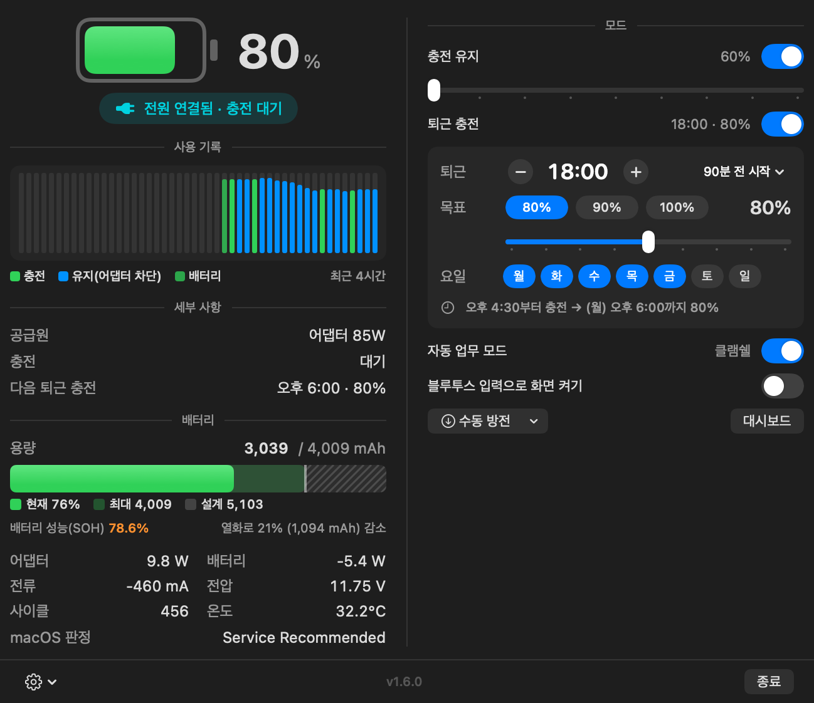
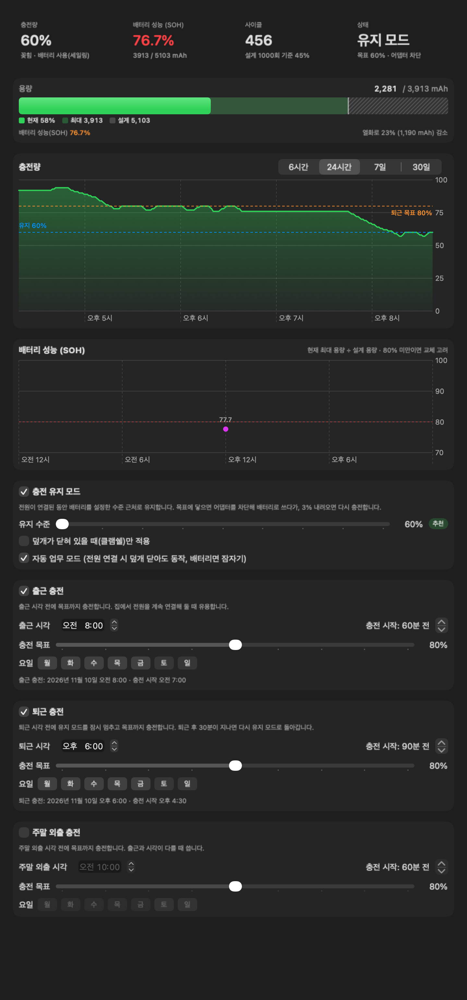
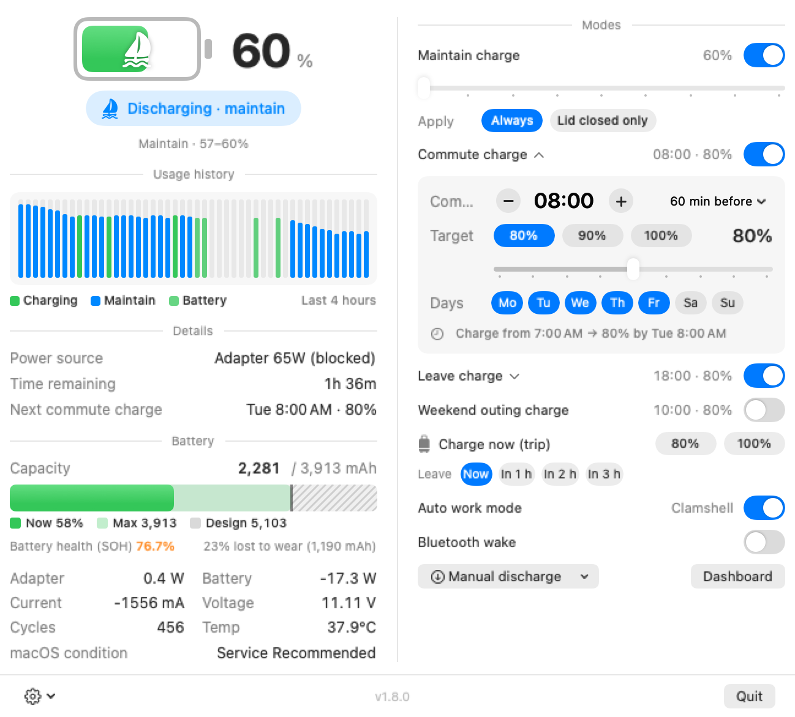
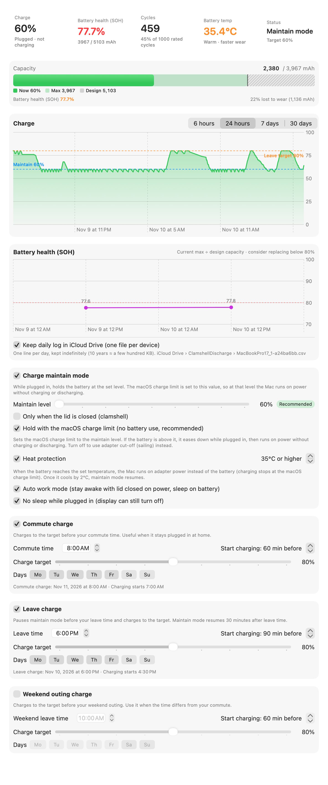

# Clamshell Discharge

Apple Silicon MacBook을 **덮개를 닫은 채(클램쉘) 외장 모니터에 연결해 쓰는 사람**을 위한 배터리 관리 메뉴 막대 앱입니다.

- 전원을 꽂아 둔 동안 배터리를 **60% 근처로 유지**해서 노화를 늦춥니다.
- **출근·퇴근 시각에 맞춰** 원하는 만큼 미리 충전하고, 출장 갈 때는 버튼 하나로 **지금 바로 80% / 100%**까지 충전합니다.
- 어댑터를 꽂은 채로 **능동 방전**할 수 있고, 클램쉘 상태에서도 잠들지 않습니다.
- 배터리 상태(SOH), 용량, 사용 기록을 한눈에 보여 줍니다.

<p>
  
</p>

<details>
<summary>대시보드 · English 화면</summary>

<p>
  
  
  
</p>
</details>

> **Windows 미리보기:** 같은 화면 구성의 Windows 10/11 판을 만들고 있습니다. 현재는 Lenovo만 충전 제어를 지원합니다. [windows/README.md](windows/README.md) 참고.

어댑터 차단(SMC)은 [actuallymentor/battery](https://github.com/actuallymentor/battery) CLI가 설치한 도구와 권한을 사용합니다. 이 앱은 그 위에 충전 유지·퇴근 충전·클램쉘 잠자기 제어·UI를 더합니다.

## 왜 필요한가

- 노트북을 늘 전원에 꽂아 두면 배터리가 100% 근처에 오래 머물러 빨리 노화합니다.
- 최근 macOS·펌웨어에서는 "충전만 멈추는" SMC 키가 없는 기기가 있어서, 충전 한도 앱이 동작하지 않는 경우가 있습니다.
- 어댑터를 차단하면 macOS는 **배터리 전원**으로 인식합니다. 그러면 덮개를 닫았을 때 잠들고, 외장 키보드·마우스로 깨울 수도 없습니다.

이 앱은 어댑터 차단 키(`CHIE`)로 충전 구간을 유지하면서, 위 클램쉘 문제를 처리합니다.

## 기능

| 기능 | 설명 |
|---|---|
| **충전 유지 (세일링)** | 전원 연결 중 배터리를 60~100% 중 정한 수준(추천 60%) 근처로 유지합니다. 목표에 닿으면 어댑터를 차단해 배터리로 쓰고, 3% 내려오면 다시 충전합니다. "덮개가 닫혀 있을 때만" 옵션이 있습니다. |
| **출근 충전** | 집에서 밤새 전원을 연결해 두는 경우, 출근 시각(기본 08:00) 전에 목표(기본 80%)까지 충전합니다. 그 전까지는 유지 수준(60%)을 지킵니다. |
| **주말 외출 충전** | 출근과 시각이 다른 주말용 일정입니다(기본 토·일 10:00 · 80%, 꺼짐). |
| **지금 충전 (출장·외출)** | 일정과 상관없이 80% 또는 100%까지 충전합니다. **출발: 지금 / 1·2·3시간 후**를 고르면, 이 Mac의 실제 충전 속도(기록에서 학습)로 계산해 **출발 직전에 다 차도록 늦게 시작**합니다. 그래서 높은 %로 오래 머물지 않습니다. 목표에 닿은 뒤 어댑터를 뽑으면 자동으로 해제되고, 최대 24시간 유지됩니다. 우선순위는 지금 충전 → 출근·퇴근 충전 → 충전 유지입니다. |
| **퇴근 충전** | 퇴근 시각(기본 18:00), 요일, 충전 시작 시점(기본 90분 전), 목표(기본 100%)를 정하면 그 시간대에 유지 모드를 멈추고 목표까지 충전합니다. 퇴근 30분 뒤 유지 모드로 돌아갑니다. |
| **자동 업무 모드** | 전원이 연결돼 있고 외장 모니터가 있으면, 덮개를 닫아도(어댑터 차단 중이어도) 잠들지 않습니다. 배터리 상태이거나 덮개를 닫았는데 모니터가 없으면 바로 잠듭니다. |
| **퇴근 감지** | 덮개를 닫은 채 외장 모니터나 어댑터를 뽑으면 방전·차단을 멈추고, 잠자기 설정을 되돌린 뒤 바로 잠듭니다. |
| **화면 깨우기** | 클램쉘에서 모니터가 꺼지면 어댑터 차단을 풀어 AC 전원으로 돌립니다. 그래서 USB 키보드·마우스로 깨울 수 있습니다. 블루투스 입력도 감지해서 화면을 켭니다(입력 모니터링 권한 필요). |
| **수동 방전** | 꽂힌 채로 목표(50~90%)까지 방전합니다. 실행 중에도 목표를 바로 바꿀 수 있고, 클램쉘에서도 잠들지 않습니다. |
| **팝오버 (메인 화면)** | 배터리 %·상태, 최근 4시간 사용 기록, 공급원·남은 시간, 용량 막대(현재 / 최대 / 설계)와 SOH, 전력·전류·전압·사이클·온도를 보여 주고, 모든 모드를 바로 제어합니다. 스크롤 없이 한 화면입니다. |
| **대시보드** | 충전량 그래프(6시간~30일), 일별 SOH 그래프, 유지·퇴근 충전 세부 설정을 제공합니다. 기록은 1분마다 로컬에 저장하고 90일치를 보관합니다. |
| **다국어** | 한국어 · English · 日本語 · 简体中文. 기본은 시스템 언어이고, ⚙︎ → 언어에서 바꿀 수 있습니다. |

## 요구 사항

- Apple Silicon MacBook, macOS 13 이상
- [battery CLI](https://github.com/actuallymentor/battery) 설치 (관리자 비밀번호 필요)
  ```bash
  curl -s https://raw.githubusercontent.com/actuallymentor/battery/main/setup.sh | bash
  ```
- AlDente 같은 **다른 충전 관리 앱은 제거**해야 합니다. 같은 SMC 키를 건드려서 서로 충돌합니다.

## 설치

### 1. 앱 내려받기와 첫 실행 (Gatekeeper 허용)

이 앱은 유료 Apple 개발자 인증서(Developer ID)로 서명·공증되지 않았습니다. 그래서 처음 열 때 macOS가 "확인되지 않은 개발자"라며 막습니다. 아래처럼 **한 번만** 허용하면 됩니다.

1. [Releases](../../releases)에서 `ClamshellDischarge-<버전>.zip`을 받아 압축을 풀고, `ClamshellDischarge.app`을 `/Applications`로 옮깁니다.
2. 앱을 엽니다. "열 수 없습니다" 또는 "확인되지 않은 개발자" 창이 뜨면 **완료**(또는 취소)를 누릅니다.
3. **시스템 설정 → 개인정보 보호 및 보안**으로 갑니다. 아래쪽 보안 항목에 *"ClamshellDischarge"이(가) 차단되었습니다*가 보이면 **그래도 열기**를 누릅니다.
4. 관리자 비밀번호(또는 Touch ID)로 확인하고, 다시 뜨는 창에서 **열기**를 누릅니다.

> macOS 15(Sequoia)부터는 예전처럼 **우클릭 → 열기**로 바로 여는 방법이 막혔습니다. 위의 **그래도 열기** 방식을 써야 합니다.
>
> 터미널에 익숙하다면 `xattr -dr com.apple.quarantine /Applications/ClamshellDischarge.app` 으로 다운로드 표시를 지워도 됩니다.

### 2. 앱이 요청하는 권한

기능에 따라 아래 권한이 필요합니다. 모두 **처음 한 번만** 설정하면 됩니다.

| 권한 | 언제 필요한가 | 어떻게 허용하나 |
|---|---|---|
| **battery CLI 설치** (관리자 비밀번호) | 충전 유지 · 퇴근 충전 · 방전, 즉 어댑터를 차단하는 모든 기능 | [요구 사항](#요구-사항)의 설치 명령을 터미널에서 실행합니다. SMC 쓰기 명령이 비밀번호 없이 허용되도록 `/etc/sudoers.d/battery`가 만들어집니다. |
| **잠자기 제어 권한** (관리자 비밀번호) | 수동 방전 · 자동 업무 모드(덮개를 닫아도 동작) | 팝오버의 **권한 설정 (최초 1회)…** 를 누르고 비밀번호를 입력합니다. `/etc/sudoers.d/clamshell-discharge`가 만들어지며, 허용되는 명령은 아래 두 개뿐입니다. 덮개가 닫힌 상태에서는 비밀번호 창을 띄울 수 없기 때문에 필요합니다. |
| **입력 모니터링** | 블루투스 키보드·마우스로 꺼진 화면 켜기 | 처음 실행할 때 macOS가 묻습니다. 놓쳤다면 팝오버의 **설정 열기**를 누르거나, **시스템 설정 → 개인정보 보호 및 보안 → 입력 모니터링**에서 ClamshellDischarge를 켭니다. 켠 뒤에는 앱을 다시 실행합니다. 입력이 **있었는지만** 감지하고, 어떤 키를 눌렀는지는 읽지 않습니다. 화면이 꺼져 있는 동안에만 감시합니다. |
| **로그인 항목** (선택) | 로그인할 때 자동 실행 | 팝오버 ⚙︎ → **로그인 시 자동 실행**. macOS가 "로그인 항목이 추가됨" 알림을 보여 줍니다. |

잠자기 제어 권한으로 추가되는 규칙:

```
<사용자> ALL = (root) NOPASSWD: /usr/bin/pmset -a disablesleep 0, /usr/bin/pmset -a disablesleep 1
```

### 3. 업데이트할 때

- 새 버전의 zip으로 앱을 바꾸면 **1번의 "그래도 열기"를 다시** 해야 할 수 있습니다.
- 배포 zip은 임시(ad-hoc) 서명이라, macOS가 새 버전을 다른 앱으로 볼 수 있습니다. 그래서 **입력 모니터링 권한이 풀릴 수 있습니다.** 입력 모니터링 목록에 켜져 있는데도 앱에 "권한 필요"가 보이면, 목록에서 ClamshellDischarge를 **−** 로 지운 뒤 앱을 다시 실행해 허용하세요.
- 잠자기 제어 권한과 battery CLI는 앱 서명과 상관없어서 유지됩니다.
- 소스로 직접 빌드할 때 Apple Development 인증서가 있으면(무료 Apple ID로 Xcode에서 만들 수 있음), `./build.sh --install`이 그 인증서로 서명합니다. 이렇게 하면 다시 빌드해도 권한이 유지됩니다. [빌드](#빌드) 참고.

## 사용법

### 처음 설정 (5분)

1. battery CLI를 설치하고, 앱을 설치해 실행합니다([설치](#설치)).
2. 메뉴 막대 아이콘을 눌러 팝오버를 열고 **권한 설정 (최초 1회)…** 를 누릅니다.
3. **모드**에서 아래 세 가지를 켭니다.
   - **충전 유지 60%**: 켜면 자동 업무 모드도 같이 켜집니다. 바로 아래 **적용**은 **항상**을 추천합니다. 그러면 집에서 덮개를 열고 일할 때도 60%를 유지합니다. **덮개 닫혔을 때만**을 고르면 사무실(클램쉘)에서만 유지합니다.
   - **퇴근 충전**: 퇴근 시각과 목표를 정합니다(아래 참고).
   - **블루투스 입력으로 화면 켜기**: 블루투스 키보드나 트랙패드를 쓴다면 켜고, 입력 모니터링을 허용합니다.
4. ⚙︎ → **로그인 시 자동 실행**을 켜 둡니다.

### 평소 (사무실, 덮개 닫고 외장 모니터로 사용)

- 그냥 쓰면 됩니다. 배터리가 60%보다 높으면 어댑터를 차단해 배터리로 내려가고(⛵), 57%까지 내려오면 다시 충전합니다.
- 덮개를 닫고 있어도 잠들지 않습니다(자동 업무 모드).
- 자리를 비워 모니터가 꺼지면 잠시 AC 전원으로 돌아갑니다. 키보드·마우스를 누르면 화면이 켜지고, 다시 유지 모드로 돌아갑니다.

### 퇴근 충전 설정

팝오버 **모드 → 퇴근 충전**을 켜면 편집 칸이 펼쳐집니다.

- **퇴근 시각**: `− 18:00 +`로 15분씩 조정합니다. 가운데 시각을 누르면 자주 쓰는 시각을 고를 수 있습니다.
- **충전 시작**: 오른쪽 메뉴에서 30~180분 전 중에서 고릅니다. 60%에서 100%까지 보통 1시간 안팎 걸립니다.
- **목표**: 80, 90, 100% 버튼이나 슬라이더로 정합니다. 하루 이동이 짧으면 80%로도 충분합니다.
- **요일**: 출근하는 요일만 켭니다.
- 아래 요약 줄(예: "오후 4:30부터 충전 → (월) 오후 6:00까지 80%")로 다음 일정을 확인합니다.

### 출근 충전 (집에서 계속 전원 연결)

- 팝오버 **모드 → 출근 충전**을 켭니다. 이름 옆 ▾를 누르면 편집 칸이 펼쳐집니다.
- 출근 시각과 목표(예: 08:00 · 80%)를 정합니다. 퇴근 충전과 같은 방식으로 편집합니다.
- 충전 유지의 **적용**을 **항상**으로 두면, 집에서 일할 때와 밤새 60%를 유지하다가 출근 전에 80%를 채웁니다.
- Mac이 밤새 잠들어 있으면 앱이 동작하지 않습니다. 이때는 macOS 충전 한도(80%)가 대신 상한을 지킵니다.

### 출장·외출 전 (지금 충전)

- 팝오버 **지금 충전 (출장·외출)**에서 먼저 **출발** 시점(지금 / 1시간 후 / 2시간 후 / 3시간 후)을 고르고, **80%** 또는 **100%**를 누릅니다.
  - **지금**: 바로 충전을 시작합니다. 남은 시간도 표시됩니다.
  - **N시간 후**: 출발 시각에 맞춰 다 차도록 늦게 시작합니다(예: "13:00 출발 · 12:05부터 충전"). 그 전까지는 유지 수준을 지킵니다. 예상 시간은 이 Mac의 실제 충전 속도로 계산하고, 15분 여유를 둡니다.
- 진행 중에도 출발 시점을 바꿀 수 있습니다.
- 목표에 닿은 뒤 어댑터를 뽑고 나가면 자동으로 해제됩니다. 다시 누르거나 **해제**를 누르면 바로 끝납니다.
- 100%가 필요하면 macOS 충전 한도도 잠시 100%로 올려야 합니다. 그대로 두면 한도에서 멈춥니다.

### 주말

- 주말에 집에서 계속 전원을 연결해 두면 출근·퇴근 일정(월~금)은 동작하지 않고 **60%를 유지**합니다.
- 주말에 정해진 시각에 나간다면 **주말 외출 충전**을 켜고 시각과 목표를 정하세요. 출근과 같은 시각이면 출근 충전의 요일에 토·일을 추가해도 됩니다.
- 즉흥적으로 나갈 때는 **지금 충전**에서 출발 시점(예: 1시간 후)을 고르면 됩니다.

### 퇴근할 때

1. **외장 모니터 케이블을 먼저 뽑고**, 그다음 전원 어댑터를 뽑습니다.
2. 덮개가 닫혀 있으면 앱이 이를 감지해 방전·차단을 멈추고 **약 10초 안에 잠자기**에 들어갑니다.
3. 처음 몇 번은 가방에 넣기 전에 잠들었는지(키보드 불빛 등) 확인하세요.

### 수동 방전

- 팝오버 **수동 방전 ▾**에서 목표(50~90%)를 고르면 시작합니다.
- 진행 중에는 **− / +** 와 목표 버튼으로 **다시 시작하지 않고** 목표를 바꿀 수 있습니다. 10초 안에 반영됩니다.
- **중지**를 누르거나 목표에 도달하면 어댑터 차단과 잠자기 설정이 원래대로 돌아옵니다.
- 유지 모드가 켜져 있다면 수동 방전이 필요한 경우는 드뭅니다. 배터리를 한 번 많이 써서 보정하고 싶을 때 등에 씁니다.

### 메뉴 막대 아이콘 읽는 법

| 아이콘 | 의미 |
|---|---|
| ⚡ `80%` | 충전 중 |
| ⛵ `80%` | 유지 모드: 어댑터를 차단하고 배터리로 쓰는 중 |
| ↓ `80%→60` | 수동 방전 중 (목표 60%) |
| 🔌 `80%` | 전원 연결됨, 충전 대기 |
| 🔋 `80%` | 배터리 사용 중 (어댑터 없음) |
| `80%⏰` | 퇴근 충전 시간대 |

우클릭하면 간단한 메뉴(방전, 모드, 대시보드, 종료)가 나옵니다.

### 용량 막대와 SOH 읽는 법

```
[■■■■■■■■■■■■■■░░░░│▨▨▨▨▨]
 현재 충전량    남은 공간 │ 열화로 줄어든 용량
 └──── 현재 최대 용량 ────┘
 └────────── 설계 용량(새 배터리) ──────────┘
```

- **SOH(State of Health)** = 현재 최대 용량 ÷ 설계 용량. macOS의 "최대 용량"과 같은 기준입니다.
- 80% 아래로 내려가면 macOS가 "서비스 권장"으로 표시할 수 있습니다. 이 앱은 노화 속도를 늦출 뿐, 줄어든 용량을 되돌리지는 못합니다.

## 사용 시 주의사항

**안전**
- SMC(시스템 관리 컨트롤러)를 직접 건드리는 도구입니다. **본인 책임 하에 사용하세요.**
- 수동 방전 중이거나 자동 업무 모드로 전원이 연결된 동안에는 **덮개를 닫아도 잠들지 않습니다.** 가방에 넣기 전에 반드시 케이블을 뽑고 잠들었는지 확인하세요. 켜진 채 가방에 넣으면 뜨거워질 수 있습니다.
- 고온(40°C 이상)에서는 충전과 방전 모두 배터리에 좋지 않습니다. 팝오버의 온도가 주황색이면 무거운 작업을 줄이세요.

**다른 앱과 함께 쓰기**
- AlDente, 다른 충전 한도 앱, `battery maintain`을 **동시에 쓰지 마세요.** 같은 SMC 키를 서로 바꿔서 동작이 엉킵니다.
- **macOS 충전 한도(macOS 26.4 이상)를 80%로 설정하는 것을 추천합니다.** 시스템 설정 → 배터리 → 충전 옆 ⓘ에서 고를 수 있습니다.
  - macOS가 직접 지키는 상한이라 **Mac이 잠든 동안이나 이 앱이 꺼져 있을 때도** 80%를 넘지 않습니다. 이 앱은 그보다 낮은 유지(60%)와 퇴근 전 충전을 맡습니다.
  - 퇴근 충전 목표는 이 한도보다 높게 잡아도 한도에서 멈춥니다. 장거리 이동 전에 100%가 필요하면 시스템 설정에서 한도를 잠시 올리세요.
  - 충전 한도가 없는 이전 macOS에서는 "최적화된 배터리 충전"을 꺼 두는 것을 권장합니다. 80%에서 충전이 멈추는 등 동작이 겹칠 수 있습니다.

**알아두면 좋은 동작**
- 유지 모드는 "충전만 멈추기"가 아니라 **어댑터 입력을 끊는** 방식입니다. 차단 중에는 Mac 전체가 배터리로 동작하므로, 무거운 작업을 하면 배터리가 빨리 내려갑니다. 57~60% 사이를 오가는 얕은 충방전은 배터리에 부담이 거의 없습니다.
- **잠자기 직전과 앱 종료 시에는 항상 어댑터 차단을 풉니다.** 그래서 잠든 동안이나 앱이 꺼진 동안에는 macOS가 정상 충전해서, 유지 수준보다 높아질 수 있습니다. 앱이 다시 동작하면 유지 수준으로 내려갑니다.
- 클램쉘에서 **모니터가 꺼지면 AC 전원으로 돌아갑니다.** 키보드·마우스로 깨울 수 있게 하기 위해서이고, 자리를 비운 동안 조금 충전될 수 있습니다.
- 자동 업무 모드에서 전원이 연결돼 있으면, 덮개를 연 상태에서도 **시스템 잠자기가 막힙니다.** 디스플레이는 평소처럼 꺼집니다.
- 블루투스로 화면 켜기는 시스템이 깨어 있을 때(자동 업무 모드)만 동작합니다. 시스템이 완전히 잠들었다면 USB 입력이나 덮개 열기로 깨우세요.
- 앱을 **업데이트하거나 다시 시작할 때는 덮개를 연 상태에서** 하는 것이 안전합니다. 앱은 종료할 때 어댑터 차단을 풀고 AC 전원이 확인된 뒤에 잠자기 설정을 되돌리지만, 덮개를 닫은 채 배터리 상태가 되면 macOS가 바로 잠들고 외장 키보드·마우스로 깨울 수 없습니다.
- 어댑터 연결 여부는 USB-C 전원 계약(PD) 정보로 판단합니다. 어댑터를 차단해도 계약은 유지되고, 뽑으면 바로 사라집니다.
- macOS가 배터리 정보를 몇 초 늦게 갱신해서, 어댑터를 막 차단하거나 푼 직후 배지(충전 중 / 방전 중)가 잠깐 어긋날 수 있습니다.
- 다른 앱(Stats 등)의 배터리 상태 값은 기준이 달라 이 앱의 SOH와 조금 다를 수 있습니다.

**문제가 생겼을 때**
- 앱이 비정상 종료돼 어댑터가 계속 차단돼 있거나, 덮개를 닫아도 잠들지 않는다면 아래 명령으로 원래대로 돌립니다.
  ```bash
  /Applications/ClamshellDischarge.app/Contents/Resources/clamshell-discharge --restore
  sudo pmset -a disablesleep 0
  ```
- MagSafe가 없는 모델에서 로그에 `SMCWriteKey ... e00002bc` 오류가 보일 수 있습니다. LED 관련이라 무시해도 됩니다.
- 기기에 따라 SMC 키가 다를 수 있습니다. 동작하지 않으면 [Issues](../../issues)에 기종과 macOS 버전을 알려 주세요.

**개인정보**
- 모든 데이터는 이 Mac에만 저장됩니다. 사용 기록은 `~/Library/Application Support/ClamshellDischarge/history.csv`, 방전 로그는 `~/.battery/clamshell-discharge.log`에 있습니다. 외부로 전송하지 않습니다.
- 입력 모니터링은 화면이 꺼져 있는 동안 **입력이 있었는지만** 확인하고, 키 내용은 읽지 않습니다.

## CLI

앱 번들에 들어 있는 스크립트를 터미널에서 직접 쓸 수도 있습니다.

```bash
/Applications/ClamshellDischarge.app/Contents/Resources/clamshell-discharge 80         # 80%까지 방전
echo 70 > ~/.battery/clamshell-discharge.target                                         # 실행 중 목표 변경
/Applications/ClamshellDischarge.app/Contents/Resources/clamshell-discharge --restore  # 비상 복구
```

## 빌드

Xcode(또는 Command Line Tools)의 `swiftc`가 필요합니다.

```bash
./build.sh            # build/ClamshellDischarge.app + zip
./build.sh --install  # + /Applications 설치
```

`--install`은 키체인에 **Apple Development** 또는 **Developer ID Application** 인증서가 있으면, 설치본을 그 인증서로 다시 서명합니다. 다른 인증서를 쓰려면 `SIGN_ID="인증서 이름" ./build.sh --install`처럼 지정합니다. 인증서가 없으면 임시(ad-hoc) 서명 그대로 설치되고, 이 경우 다시 빌드할 때마다 입력 모니터링 권한을 새로 허용해야 합니다. 배포 zip은 개인 정보(인증서 이름)가 들어가지 않도록 항상 ad-hoc 서명입니다.

- 번역: `Sources/L10n.swift`의 표(한국어 원문이 키). `python3 tools/wrap_strings.py --apply Sources/<파일>.swift`가 새 한국어 문자열을 번역 키로 감싸고, `--list`로 키 목록을 볼 수 있습니다.
- 앱 아이콘: `icon/MakeIcon.swift`

## 제거

```bash
sudo rm /etc/sudoers.d/clamshell-discharge
rm -rf /Applications/ClamshellDischarge.app ~/.battery/clamshell-discharge.*
sudo pmset -a disablesleep 0
```

그 밖에 **시스템 설정 → 개인정보 보호 및 보안 → 입력 모니터링**과 **일반 → 로그인 항목**에서 ClamshellDischarge를 지웁니다. battery CLI도 지우려면 [battery 저장소](https://github.com/actuallymentor/battery)의 제거 방법을 따릅니다.

## 라이선스

MIT
